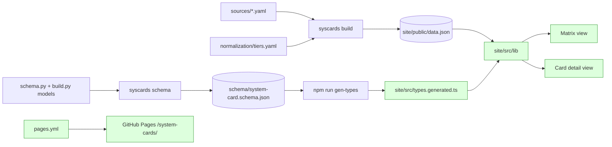

# Site: matrix and card detail

Issue: #2 · **Status: design** · Baseline: `main` @ `17bff7a` · Implementer: `opus` (`.claude/commands/implement.md`)

---

## 1. Spec

Class: new feature surface.

### Goal
A reader opens the public Pages URL and sees, for every card in `sources/`, what the card says about safety: framework tier with the lab's own term, each risk domain, third-party testers, evaluation coverage, length and date. Every cell traces on hover or focus to a page and a verbatim quote, with a link into the lab's PDF at that page. The reader can sort and filter the matrix and share the resulting link. A second view lists every fact on one card with its cite.

### Scope
**In:**
- Vite + React + TypeScript app under `site/` (strict TS, Vitest, eslint; scripts `lint`, `typecheck`, `test`, `build`, `gen-types`); `types.generated.ts` from the schema export.
- Matrix view: rows grouped by lab, date-ascending; columns per `docs/plan.md` section 7.1. Status shown by glyph and text as well as color. Hover/focus card with raw term, quote, page, PDF link at `#page=N`.
- Sort by any column; filter by lab, rung, and model-name text; sort and filters live in the URL.
- Card detail view: every fact path and third-party assessment with status, value, cite.
- Light only; palette D10.
- `pages.yml` deploy; a `check.yml` site job when `site/` or the schema changes.

**Out:** compare, timeline, gaps views; dark mode; lab logos; pretty names for labs or tester orgs; layouts beyond not overflowing a phone viewport; a backend or global store.

### Acceptance criteria
| # | Criterion |
|---|---|
| AC1 | The public Pages URL at `/system-cards/` renders all four cards; a detail URL and a sorted/filtered URL survive a hard reload. |
| AC2 | Every status is distinguishable with color removed (glyph or text). |
| AC3 | Each `reported`/`withheld` cell's hover or focus shows quote, page and a link opening the lab's PDF at that page. |
| AC4 | No lab name, tier-to-rung mapping, or status meaning appears in `site/src`; rung descriptions and labs come from `data.json`. |
| AC5 | `npm run lint`, `typecheck`, `test`, `build` pass offline; CI runs them when `site/` or the schema changes. |
| AC6 | `types.generated.ts` comes from `gen-types`; CI fails if it drifts from the schema export. |

### User-visible behaviors
1. `/` shows a matrix with 4 rows under 3 lab groups, date-ascending within a group.
2. Tier cell shows raw term and rung (`CB-1 · elevated`); the stub card shows the unknown mark and its row is dimmed.
3. Domain cells show the outcome label and meter; hover shows `raw_threshold`, quote, page, PDF link.
4. Third-party cell lists testers (`org_name` or enum slug); `not_reported` shows its mark.
5. Alignment and agentic cells show `reported/total`; hover lists each sub-fact and its status, withheld ones included.
6. Pages and published appear as given, `—` when null.
7. Clicking a model name (several joined with " & ") opens `#/cards/<id>` with every fact and cite.
8. Clicking a column header sorts by it; while sorted, rows are not grouped; clearing the sort restores groups.
9. Filtering by lab, rung or name text narrows the rows; reloading the URL keeps sort and filters.
10. Keyboard focus on a cell shows the same content as hover.

### Open questions
None. Resolved: withheld = ◐ + "withheld"; the stub card stays in its group, dimmed; group counts are `reported` only.

---

## 2. Design

### Context


### Capability A — Typed dataset contract (Python)
`build.py:card_record` returns a dict and `cli.py:schema` exports `Card` only, so the build's derived fields have no generated type. A types the build output in pydantic and makes `Dataset` the export root. `data.json` is unchanged except one new top-level field, `domain_outcomes`, and key order (`lab` moves to the end of each card).

**Data**
| Model | Change | Notes |
|---|---|---|
| `Strict` | config `json_schema_serialization_defaults_required=True`; the export uses `mode="serialization"` | defaulted fields become required in the export only; the validation schema is unchanged |
| `Card.lab` | property becomes a pydantic `@computed_field` | appears in `model_dump` and the export as a required string; a YAML `lab:` key is still rejected; call sites unchanged; excluded when re-validating into `CardRecord` (`extra="forbid"`); mypy needs `# type: ignore[prop-decorator]` |
| `Coverage` | new `Strict` model, one `int` field per `Status` member | `dict[Status, int]` generates `{[k: string]: number}`; named fields make a typo a type error |
| `CardRecord(Card)` | adds `normalized_tier: str \| None`, `withheld: list[str]`, `not_reported: list[str]`, `coverage: Coverage` | `build.py` |
| `Dataset` | `schema_version: str`, `normalization_version: int`, `rungs: dict[str, str]`, `fact_paths: list[str]`, `domain_outcomes: list[DomainOutcome]`, `cards: list[CardRecord]` | export root, `build.py` |
| `DOMAIN_OUTCOME_LADDER` | tuple in `schema.py`: `DomainOutcome` members in enum order minus `not_assessed`, derived from the enum, not listed by hand | the steps of the outcome meter |

**Component design**
| Unit | Kind | Builds on | Owns / seam |
|---|---|---|---|
| `Coverage`, `CardRecord`, `Dataset` | model | `Card`, `Status`, `DomainOutcome` | the site's contract; no logic |
| `card_record` | build fn | `iter_facts`, `TierTable.rung_for` | returns `CardRecord`; derivations unchanged |
| `build_dataset` | build fn | `load_card`, `source_paths` | builds `Dataset`, returns `model_dump(mode="json")`, so `write_dataset` and tests keep a dict |
| `dataset_schema` | build fn | `Dataset` | `Dataset.model_json_schema(mode="serialization")`, the one spelling of the export |
| `cli.schema` | CLI command | `dataset_schema` | writes and checks the export; file name unchanged |

### Capability B — Site scaffold, matrix, sort and filter
A Vite app at base `/system-cards/` fetches `BASE_URL + "data.json"` once and renders the matrix with TanStack Table (headless; our markup and theme). React Router in hash mode owns the route; sort and filters are URL search params, so links share a view. Cite-bearing cells are buttons that open a popover on hover or focus.

State ownership: the root route's loader owns the dataset (fetched once, never revalidated); the URL owns route, sort and filters; each popover owns its open state. No global store.

**Component design**
| Unit | Kind | Builds on | Owns / seam |
|---|---|---|---|
| `site/` config: `package.json`, `vite.config.ts` (`base`), `tsconfig.json` (strict), `eslint.config.js`, Vitest (jsdom), `index.html` | config | — | the five npm scripts |
| `types.generated.ts` | type | json-schema-to-typescript on the export | never hand-edited |
| `lib/data.ts:loadDataset` | lib fn | `Dataset` | the one fetch; the seam a future backend replaces |
| `lib/facts.ts`: `factAt`, `groupCount`, `isStub` | lib fn | `fact_paths`, `coverage` | walking a card by dotted path; `groupCount` counts `reported` over the prefix's paths |
| `lib/format.ts`: `statusMark`, `humanize`, `outcomeLevel`, `pdfPageUrl` | lib fn | `Status`, `domain_outcomes` | exhaustive `Record<Status, …>` glyph and label; `outcomeLevel` is `null` off the ladder; `pdfPageUrl` replaces any fragment |
| `lib/columns.ts:matrixColumns` | lib fn | TanStack `ColumnDef`, `fact_paths` | fixed columns always; domains from `framework.domains.*` paths; header map is casing only, `humanize` fallback; sort accessors per column |
| `lib/viewState.ts`: `parseViewState`, `toSearchParams` | lib fn | `URLSearchParams` | sort column and direction, lab, rung, text; unknown keys ignored |
| `lib/rows.ts:groupByLab` | lib fn | build order | contiguous groups, no re-sort |
| `routes.tsx` | router | React Router `createHashRouter` | root route `loader: loadDataset`, `shouldRevalidate: () => false`, `errorElement`, `HydrateFallback`; children `/` and `/cards/*` (ids are URL-safe per `ID_PATTERN`, so the splat is the raw id); the only file that changes for browser routing |
| `App.tsx`, `main.tsx` | component | router, `useLoaderData` | layout and the empty-dataset state |
| `Matrix.tsx` | component | TanStack Table, columns, rows, view state | `<table>` in an `overflow-x: auto` box; grouped when unsorted; stub row dimmed; pages and published plain `<td>` |
| `MatrixFilters.tsx` | component | view state, `cards`, `rungs` | lab and rung selects built from data, name search |
| `MatrixCell.tsx` | component | facts, format | tier: raw term plus rung, raw term alone if `normalized_tier` is null; third party: names, or mark plus summary value when reported with no assessments |
| `StatusMark.tsx`, `OutcomeMeter.tsx` | component | format | glyph plus label; meter steps = ladder length; label only when level is null |
| `CitePopover.tsx` | component | `@floating-ui/react` (hover with safePolygon, focus, dismiss) | quote, page, raw term, rung description from `rungs`, PDF link; max-width, wraps |
| `theme.css` | style | `@fontsource-variable/newsreader`, `/inter` | every color, font and space as a CSS variable; components use variables only |

### Capability C — Card detail view
`CardDetail.tsx` at `#/cards/<id>`: document header (title, models, published, pages, PDF link, `provenance.verification`), one row per `fact_paths` entry (status, value or outcome, `raw_threshold`, note, cite page link, quote, cite note), then third-party assessments with their cites. An id not in `cards` shows "no card with this id" and a link back.

| Unit | Kind | Builds on | Owns / seam |
|---|---|---|---|
| `CardDetail.tsx` | component | `factAt`, `statusMark`, `pdfPageUrl`, `StatusMark`, `OutcomeMeter` | one card's facts in `fact_paths` order |

### Capability D — Deploy and CI
| Unit | Kind | Owns |
|---|---|---|
| `.github/workflows/pages.yml` | workflow | push to main and dispatch; `contents: read`, `pages: write`, `id-token: write`; `concurrency: pages`; uv sync, `syscards check --quiet`, `syscards build`, Node 22, `npm ci`, `npm run build`, upload `site/dist`, deploy-pages |
| `check.yml` job `site` | workflow | gated by dorny/paths-filter on `site/**`, `schema/**`, `.github/workflows/**`: `npm ci`, `gen-types` then `git diff --exit-code`, AC4 grep (lab directory names from `sources/` must not appear in `site/src`), lint, typecheck, test, build |

### Reuse and refactor inventory
| Existing block | Path | Decision | Evidence / why |
|---|---|---|---|
| `iter_facts` | `src/system_cards/schema.py:iter_facts` | reuse as-is | source of `fact_paths` |
| `card_record`, `build_dataset` | `src/system_cards/build.py` | generalize (typed), in-PR slice A1 | callers: `cli.py:build`, `tests/test_build.py` only |
| `Card.lab` | `src/system_cards/schema.py:Card` | make a computed field | `rg "\.lab\b" src tests`: `build.py` only |
| `TierTable.rungs`, `TierTable.version` | `src/system_cards/normalization.py:TierTable` | reuse as-is | already emitted |
| `DomainOutcome` | `src/system_cards/schema.py:DomainOutcome` | reuse; ladder new | enum order is severity order |
| `cli.schema`, schema pin | `src/system_cards/cli.py:schema`, `tests/test_repo_data.py:test_checked_in_json_schema_matches_models` | export root becomes `Dataset`; both call `dataset_schema` | `rg "model_json_schema" src tests`: 2 hand spellings today |
| Site blocks | `docs/building-blocks.md` "Site" | new | no tracked `site/` at `17bff7a` |
| TanStack Table | npm | new dependency | sort, filter, grouping; headless, so the theme is ours |
| React Router | npm | new dependency | hash mode now, browser mode later without touching views |
| `@floating-ui/react` | npm | new dependency | an interactive popover needs hover intent, focus and dismiss |
| `@fontsource-variable/*` | npm | new dependency | self-hosted fonts; invariant 7 allows no fetch but `data.json` |
| Redux / RTK | — | rejected | one read-only dataset; view state belongs in the URL |

### Settled decisions
| # | Decision | Why | ADR |
|---|---|---|---|
| D1 | TanStack Table for the matrix | sort, filter and grouping now and as views grow; headless keeps the theme | — |
| D2 | React Router, `createHashRouter` | Pages has no SPA fallback; moving to browser routing is a change in `routes.tsx` | [0002](adr/0002-url-owns-view-state.md) |
| D3 | `data.json` fetched at runtime from `BASE_URL` | site CI and tests need no Python | — |
| D4 | Stub card in place, dimmed when every fact is unknown; withheld = ◐ + "withheld" | spec | — |
| D5 | Outcome label = humanized enum value; meter steps from `domain_outcomes` | no restated meaning in code | — |
| D6 | Fonts self-hosted | invariant 7 | — |
| D7 | Build output typed in pydantic; `Dataset` is the export root | the site's whole contract is generated | [0001](adr/0001-typed-dataset-contract.md) |
| D8 | All colors and fonts in `theme.css` variables | a re-theme is one file | — |
| D9 | Detail view in this PR, its own commit | developer | — |
| D10 | Palette, checked with the dataviz validator: page `#EEF2F8`, ink `#16181D`, secondary `#4A4F5C`, muted `#62687A` (4.94:1), accent `#283C6B`, card surface `#FFFFFF`, outcome ramp `#9AABCD #7A8FBD #5A72A8 #3D5489 #22325A` (ordinal pass on the page color), label ink `#0F1830` on steps 1–2 and white on 3–5 (all ≥ 4.77:1) | the mockup's muted gray (2.81:1) and ramp light end failed | — |
| D11 | Vitest fixtures use synthetic labs and ids (`lab-a/model-x/2026-01`) | keeps `site/src` free of lab names (AC4) | — |
| D12 | No global store; view state in the URL; data behind `loadDataset` | a backend later swaps one function for RTK Query or TanStack Query | [0002](adr/0002-url-owns-view-state.md) |

### Size estimate
| | App | Tests | Docs | Data / config | Files | Net app lines |
|---|---|---|---|---|---|---|
| A | 3 | 1 changed | `schema.md`, `building-blocks.md`, `where-things-go.md`, `quiz-topics.md`, ADR 0001 + index | schema export | 11 | ~70 |
| B | 17 | 8 + fixtures | this doc, `building-blocks.md`, ADR 0002 | `package.json`, lockfile, 3 configs, `index.html`, `types.generated.ts` | ~35 | ~800 |
| C | 1 | 1 | this doc | — | 2 | ~120 |
| D | — | — | `plan.md` status, `quiz-topics.md`, `CLAUDE.md` | `pages.yml`, `check.yml` | 5 | — |
| **Bundled** (+20%, no prior records) | 21 | 12–13 | 11 | 9 | ~54–62 | ~1200 |

Over 15 app files and 400 lines. Split if wanted: PR-1 = A + B + D (meets the gate), PR-2 = C.

### Risks and close-read files
- **Close-read:** `build.py:card_record` and `build_dataset` (`data.json` identical except `domain_outcomes`; diff before and after slice A1); the `Strict` config; `Card.lab` as a computed field; the export root and its pin in `test_repo_data.py`.
- **Verify by hand:** repo Settings → Pages → Source "GitHub Actions" (owner); a detail URL and a sorted URL after a hard reload on Pages; `#page=N` in Chrome and Firefox on the Fable URL, which contains `%20` and `&`.
- **Infra:** new `pages.yml`; a gated site job in `check.yml`; Node 22.

---

## 3. Implementation plan

### Slice A1 — Typed dataset contract (commit 1)
- `schema.py`: on `Strict`, add `json_schema_serialization_defaults_required=True` to `model_config`.
- `schema.py:Card.lab`: `@computed_field  # type: ignore[prop-decorator]` above `@property`; keep the body. Add `DOMAIN_OUTCOME_LADDER = tuple(o for o in DomainOutcome if o is not DomainOutcome.not_assessed)` next to the enum.
- `build.py`: add `Coverage(Strict)` (fields `reported`, `withheld`, `not_reported`, `not_applicable`, `unknown`: `int`), `CardRecord(Card)`, `Dataset(Strict)` per the Data table.
- `build.py:card_record` returns `CardRecord(**card.model_dump(exclude={"lab"}), normalized_tier=…, withheld=…, not_reported=…, coverage=Coverage(**counts))`; keep the derivation code.
- `build.py:build_dataset` builds `Dataset(…, domain_outcomes=list(DOMAIN_OUTCOME_LADDER))` and returns `.model_dump(mode="json")`; key order: `schema_version`, `normalization_version`, `rungs`, `fact_paths`, `domain_outcomes`, `cards`.
- `build.py:dataset_schema() -> dict[str, Any]`; `cli.py:schema` and `tests/test_repo_data.py` both call it; run `uv run syscards schema`.
- Guard: before editing, `uv run syscards build && cp site/public/data.json $TMP/before.json`; after, rebuild; `diff <(jq -S 'del(.domain_outcomes)' $TMP/before.json) <(jq -S 'del(.domain_outcomes)' site/public/data.json)` is empty.
- Docs: `docs/schema.md` (export root, `domain_outcomes`), `docs/building-blocks.md` (`Card.lab`, `card_record`, `build_dataset`, new models), `docs/where-things-go.md` (`build.py` row), `docs/quiz-topics.md` ("Build output" row), `docs/adr/0001-typed-dataset-contract.md` status → accepted, ADR index.

### Slice B1a — Scaffold (commit 2)
- `site/package.json`: React 19, react-dom, react-router 7, @tanstack/react-table 8, @floating-ui/react, @fontsource-variable/newsreader, @fontsource-variable/inter; dev: vite, @vitejs/plugin-react, typescript, vitest, jsdom, @testing-library/react, @testing-library/user-event, eslint + typescript-eslint + react-hooks plugin, json-schema-to-typescript. Pin exact versions; commit `package-lock.json`.
- Scripts: `gen-types` = `json2ts -i ../schema/system-card.schema.json -o src/types.generated.ts`; `typecheck` = `tsc --noEmit`; `test` = `vitest run`; `lint` = `eslint .`; `build` = `tsc --noEmit && vite build`.
- `vite.config.ts`: `base: "/system-cards/"`; Vitest `environment: "jsdom"`, `setupFiles: ["src/test/setup.ts"]` (jest-dom matchers; a `ResizeObserver` stub if floating-ui needs one). `tsconfig.json`: `strict`, `noUncheckedIndexedAccess`.
- `index.html`, `main.tsx`, `routes.tsx` (root route as in the component table), `App.tsx`, `theme.css` (D10 tokens as `--color-*`, `--font-serif`, `--font-sans`, `--space-*`; `rg "#[0-9a-fA-F]{3,6}" site/src --glob '!theme.css' --glob '!*.generated.ts'` is empty), `types.generated.ts`. Done when all five scripts pass.

### Slice B1b — lib (commit 3)
- `src/test/fixtures.ts`: `makeCard(overrides)`, `makeDataset(cards)` typed `CardRecord` / `Dataset`; every fact `unknown` by default; ids like `lab-a/model-x/2026-01`.
- Signatures: `loadDataset(): Promise<Dataset>`; `factAt(card: CardRecord, path: string): Fact | DomainAssessment | undefined`; `groupCount(card: CardRecord, prefix: string, factPaths: string[]): {reported: number; total: number}`; `isStub(card: CardRecord, factPaths: string[]): boolean` (true iff `coverage.unknown === factPaths.length`).
- `statusMark(s: Status): {glyph: string; label: string}`; `humanize(s: string): string`; `outcomeLevel(v: DomainOutcome | null, ladder: DomainOutcome[]): number | null`; `pdfPageUrl(url: string, page: number): string`.
- `matrixColumns(ds: Dataset): ColumnDef<CardRecord>[]`; `groupByLab(cards: CardRecord[]): {lab: string; cards: CardRecord[]}[]`; `cardHref(id: string): string` = `/cards/${id}`.
- Docs: `docs/building-blocks.md` "Site" rows for each `lib/` function.

### Slice B1c — Matrix components (commit 4)
- `Matrix.tsx`, `MatrixCell.tsx`, `StatusMark.tsx`, `OutcomeMeter.tsx`, `CitePopover.tsx` per the component table.
- Docs: `docs/building-blocks.md` rows for the shared components; section 4 here as you go.

### Slice B2 — Sort, filter, URL state (commit 5)
- `parseViewState(p: URLSearchParams): ViewState`, `toSearchParams(s: ViewState): URLSearchParams` in `lib/viewState.ts`; `MatrixFilters.tsx`; TanStack `getSortedRowModel` and `getFilteredRowModel` driven by view state via `useSearchParams`.
- Docs: `docs/adr/0002-url-owns-view-state.md` status → accepted, ADR index.

### Slice C1 — Card detail (commit 6)
- `CardDetail.tsx` on `/cards/*`: look up `params["*"]` in `cards`; a miss is the not-found state.

### Slice D1 — Deploy, CI, docs (commit 7)
- `.github/workflows/pages.yml` and `check.yml` job `site` per capability D; `actions/setup-node` with `cache-dependency-path: site/package-lock.json`; paths-filter with `base` set for pushes to main.
- AC4 step: `! rg -i "$(ls sources | paste -sd'|')" site/src`.
- `docs/plan.md` Phase 2 status; `docs/quiz-topics.md` row **Site matrix and detail**; `CLAUDE.md` "Site (Phase 2; `site/` does not exist yet)" heading updated.

### Tests
| Test | Slice | Bug it catches | Fails because | Overlap checked |
|---|---|---|---|---|
| `tests/test_repo_data.py::test_checked_in_json_schema_matches_models` (changed: compares `dataset_schema()`) | A1 | the checked-in export drifts from the models the site types come from | the file differs from the regenerated schema | existing test; only its comparand changes |
| `tests/test_build.py::test_build_adds_normalized_tier_and_coverage` (changed: adds two asserts) | A1 | `domain_outcomes` includes `not_assessed`, or misses an outcome added to the enum, so the meter shows a non-result as a step or drops a step | asserts `"not_assessed" not in data["domain_outcomes"]` and `set(data["domain_outcomes"]) \| {"not_assessed"} == {o.value for o in DomainOutcome}` | `rg "domain_outcomes\|not_assessed" tests`: none |
| `site/src/lib/facts.test.ts`: `isStub` true only when every fact is unknown | B1b | stub detection as "nothing reported" dims a fully extracted card whose facts are all `not_reported` | fixture with every fact `not_reported` expects `false`; all `unknown` expects `true` | none |
| `site/src/lib/facts.test.ts`: `factAt` resolves a domain path and `evaluations.welfare` | B1b | a dotted-path walk that stops one level early or late returns a group object, so a cell renders the wrong fact | asserts the returned object is the fixture's Fact at that path | none (no site tests) |
| `site/src/lib/facts.test.ts`: `groupCount` counts only `reported`, total from `fact_paths` | B1b | withheld counted as reported, or a hard-coded total | fixture has 1 reported and 1 withheld of 3 paths; expects `{reported: 1, total: 3}` | none |
| `site/src/lib/format.test.ts`: `statusMark` gives each status a distinct glyph and label | B1b | two statuses render the same, so a status is color-only (AC2) | expects five distinct labels and five distinct glyphs | none |
| `site/src/lib/format.test.ts`: `outcomeLevel` is `null` for `not_assessed` | B1b | the meter shows `not_assessed` as the lowest step, reading as "below threshold" | expects `null` | none |
| `site/src/lib/format.test.ts`: `pdfPageUrl` replaces an existing fragment and keeps `%20` and `&` | B1b | `#page` appended twice or the URL re-encoded, so the PDF opens at page 1 or 404s | input `…Card%20&%20X.pdf#foo`, expects `…Card%20&%20X.pdf#page=15` | none |
| `site/src/lib/rows.test.ts`: `groupByLab` keeps build order | B1b | an alphabetical re-sort breaks date order within a lab | input in build order with names out of alphabetical order; expects the same order | none |
| `site/src/components/CitePopover.test.tsx` (uses `setup.ts` stubs): keyboard focus opens the popover with quote and a link ending `#page=N` | B1c | the popover wired to pointer hover only (behavior 10, AC3) | focuses the cell via `user.tab()`, expects the quote text and the link `href` | none |
| `site/src/components/MatrixCell.test.tsx`: reported tier with null `normalized_tier` shows the raw term alone | B1c | the cell renders "CB-1 · null" or throws on a term missing from `tiers.yaml` | expects text `CB-1` and no `null` | none |
| `site/src/lib/viewState.test.ts`: `parseViewState(toSearchParams(s))` round-trips sort and filters; an unknown param is ignored | B2 | a sorted or filtered link loses state on reload, or a shared link with `?utm=1` throws (AC1, behavior 9) | expects deep equality for a state with every field set; `utm=1&sort=published` yields the sort | none |
| `site/src/components/Matrix.test.tsx` (inside `createMemoryRouter` with the app's routes, at `/` and `/?sort=published`): unsorted renders group headers; sorted renders none, in date order across labs | B2 | sorting applied inside groups, or groups shown while sorted (behavior 8) | counts group-header rows and checks row order | none |
| `site/src/routes.test.tsx`: an id with slashes routes to the detail view; an unknown id shows not found | C1 | ids containing `/` break the detail route on reload, or a missing card throws (AC1) | uses `createMemoryRouter` with the app's routes at `/cards/lab-a/model-x/2026-01`, expects the card title; at `/cards/lab-a/missing/2026-01`, expects the not-found text | none |

### Verification
```bash
uv run pytest -q
uv run ruff check . && uv run ruff format --check . && uv run mypy
uv run syscards schema --check && uv run syscards check && uv run syscards build
cd site && npm ci && npm run gen-types && git diff --exit-code src/types.generated.ts
cd site && npm run lint && npm run typecheck && npm run test && npm run build
cd site && npm run dev   # then /ui-testing with section 1 behaviors 1-10
```

---

## 4. Drift from design
| Planned | Built | Because |
|---|---|---|
| Domain header map is casing only | `ai_rnd` shows as "AI R&D", not a casing of "ai rnd" (`site/src/lib/columns.ts:25`) | no casing of "ai rnd" reads as a word; "AI R&D" is the schema's own description of the field (`src/system_cards/schema.py:Domains`) |

**Estimate vs actual:** estimated ~50–58 files / ~1200 app lines → actual N / M.

---

## 5. As-built notes
<!-- Filled when Status becomes as-built. -->
