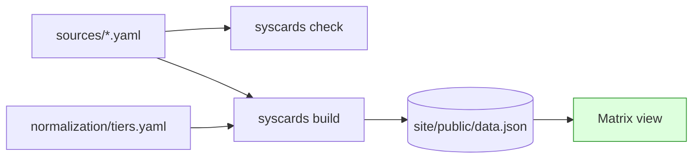
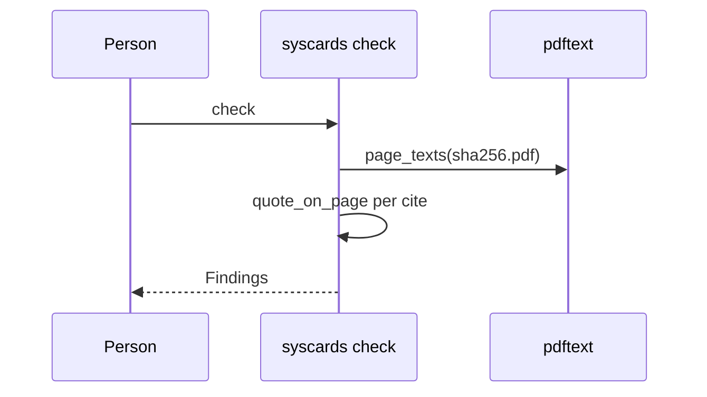

# <Feature name>

Issue: #NNN · **Status: design** | in progress | as-built · Baseline: `main` @ `<sha>` · Implementer: `<model from .claude/commands/implement.md>`

<!--
How to use this template (delete these comments in the real doc):

- NEW FEATURE SURFACE (a new CLI command family, a new check-rule family, a
  new site view, a new schema group): copy to the feature's FINAL home,
  docs/<slug>.md (docs/where-things-go.md "docs/"). It never moves. Status
  goes design -> in progress -> as-built in place.
- INCREMENT to an existing feature (a field, a keyword entry, a tier row, a
  site column, a check rule inside an existing family): do NOT create a
  permanent doc. Put sections 1-3 in the GitHub issue body (or
  docs/plans/wip/<slug>.md, marked temporary) and name the existing doc(s) it
  extends (usually docs/schema.md, docs/normalization.md or a site doc).
  Drift and estimate vs actual go in the PR body; the as-built notes merge
  into those docs. The shipping PR deletes the temporary file.
- Section 1 is approved before section 2 is written. Section 2 before section 3.
- Sections 2 and 3 are each reviewed by .claude/commands/review-plan.md
  before the developer sees them. The tests table is not shown to the
  developer; the review's Pass 6 is the only check it gets by default, and
  the final table is the contract the implementer writes to (a test outside
  it is a drift row in section 4).
- Word budgets: section 1 <= 400 words; section 2 <= 600 words of prose,
  tables and diagrams excluded; section 3 has no prose paragraphs.
- Diagrams are Mermaid. Include one only when it shows a mechanism the reader
  could not get from the table next to it.
- Cite code as path:symbol (src/system_cards/check.py:check_card), never a
  bare line number; add :line only inside a long body.
- Sections 4 and 5 are empty at design time and filled during/after
  implementation. Section 4 is the drift ledger the review brief reads.
-->

---

## 1. Spec

### Goal
<!-- One paragraph: what a reader of the site, or a person adding a card, can do afterwards that they cannot do now. -->

### Scope
**In:**
- …

**Out:**
- …

### Acceptance criteria
| # | Criterion |
|---|---|
| AC1 | … |

### User-visible behaviors
<!-- Numbered, one line each. Site change: copy-pasteable into /ui-testing. Data-layer change: a run recipe (the syscards commands and what they print). -->
1. …

### Open questions
- …

---

## 2. Design

### Context
<!-- The existing boxes this feature touches and the new ones. -->


### Capability A — <name>
<!-- Two or three sentences. One subsection per capability; a single-capability feature has one. -->

**Flow** <!-- only when the main path crosses more than two hops -->


**Data** <!-- only when the record shape changes -->
| Model | Change | Default | KEYWORDS entry | Notes |
|---|---|---|---|---|
| `AlignmentEvals` | add `goal_guarding: Fact` | `unknown` | `("goal guarding", "goal-guarding")` | schema export regenerated; existing cards untouched |

**Component design**
<!-- Every unit added or changed. Kind: model / field / validator / check rule / CLI command / build field / normalization row / lib function / component / hook / type / workflow. -->
| Unit | Kind | Builds on (from inventory) | Owns / seam | State |
|---|---|---|---|---|
| `check_card` rule: page-span quote | check rule | `Finding`, `pages_containing` | the message; knows nothing of the CLI | — |
| `MatrixCell` | component | `types.generated.ts`, `lib/status.ts` | rendering one Fact; data via props | none |

### Capability B — <name>
<!-- … -->

### Reuse and refactor inventory
<!-- Whole stack. Decision: reuse as-is / generalize first / new. "generalize first" defaults to PR 0, which pins current behavior with tests first. Evidence: path:symbol or the grep you ran. -->
| Existing block | Path | Decision | Evidence / why |
|---|---|---|---|
| `iter_facts` | `src/system_cards/schema.py:iter_facts` | reuse as-is | the site's column list is `fact_paths` from the build |
| … | … | new | `rg "<keyword>" src site/src`: nothing comparable |

### Settled decisions
<!-- Cross-cutting decisions also get docs/adr/NNNN-slug.md; link it. -->
| # | Decision | Why | ADR |
|---|---|---|---|
| D1 | … | … | — |

### Size estimate
<!-- Per capability and total, by category, as a range. Method in .claude/commands/plan-a.md step 5. -->
| | App | Tests | Docs (of which citation re-points) | Data / config | Files | Net lines |
|---|---|---|---|---|---|---|
| PR 0 (refactor) | | | | | | |
| Capability A | | | | | | |
| Capability B | | | | | | |
| **Bundled** | | | | | | |

<!-- If > 15 files or > 400 net lines: say so and show the split. The developer chooses. -->

### Risks and close-read files
<!-- Always close-read: schema validators and Status semantics; normalization/tiers.yaml rows; any check rule (what counts as verified); build.py:card_record (the site's contract); text normalization in pdftext.py; fetch.py's refuse-on-change; and on a card, every judgment fact (tier, domain outcomes, withheld, not_applicable, dismissed keyword-net warnings). Plus anything to verify by hand before merge. -->
- **Close-read:** …
- **Verify by hand:** …
- **Infra:** CI job changes, the Pages workflow, or "none".

---

## 3. Implementation plan
<!-- Written for the implementer model. Bullets of at most two lines, or tables. No prose paragraphs. -->

### PR 0 — <refactor name> (behavior-preserving)
- Files: …
- Guard: existing tests pass unchanged.

### Capability A
**Slice A1 — <name>** (one commit)
- `path/to/file.py`: …
- Docs: …

**Slice A2 — …**

**Tests — Capability A**
<!-- One row per test, CLAUDE.md rule #8. A row that cannot fill all three columns is not written. "Overlap checked" names the existing test that already covers the nearest behavior, or the grep that found none. -->
| Test | Slice | Bug it catches | Fails because | Overlap checked |
|---|---|---|---|---|
| `tests/test_check.py::test_quote_spanning_pages_is_reported` | A1 | a quote split across two pages is silently accepted | asserts an error naming both pages | `rg "found on page" tests`: only the wrong-page case exists |

### Capability B
…

### Verification
```bash
uv run pytest -q
uv run ruff check . && uv run ruff format --check . && uv run mypy
uv run syscards schema --check && uv run syscards check
# data PRs, with the PDFs cached:
uv run syscards fetch-all && uv run syscards check --require-pdfs
# site PRs:
cd site && npm run lint && npm run typecheck && npm run test && npm run build
```

---

## 4. Drift from design
<!-- Appended during implementation. Planned X, built Y, because Z. No deviation is too small if it would surprise someone who read section 2. -->
| Planned | Built | Because |
|---|---|---|
| | | |

**Estimate vs actual:** estimated N files / M app-code lines → actual N / M.
<!-- Filled by autopilot when the last slice lands. /plan-a step 5 reads the last three of these to calibrate. -->

---

## 5. As-built notes
<!-- Filled when Status becomes as-built. One claim per bullet, path:symbol trailing the claim. -->

### Where things are
- …

### Failure modes
| Symptom | Cause | Where to look |
|---|---|---|
| | | |

### Known gaps
- …
